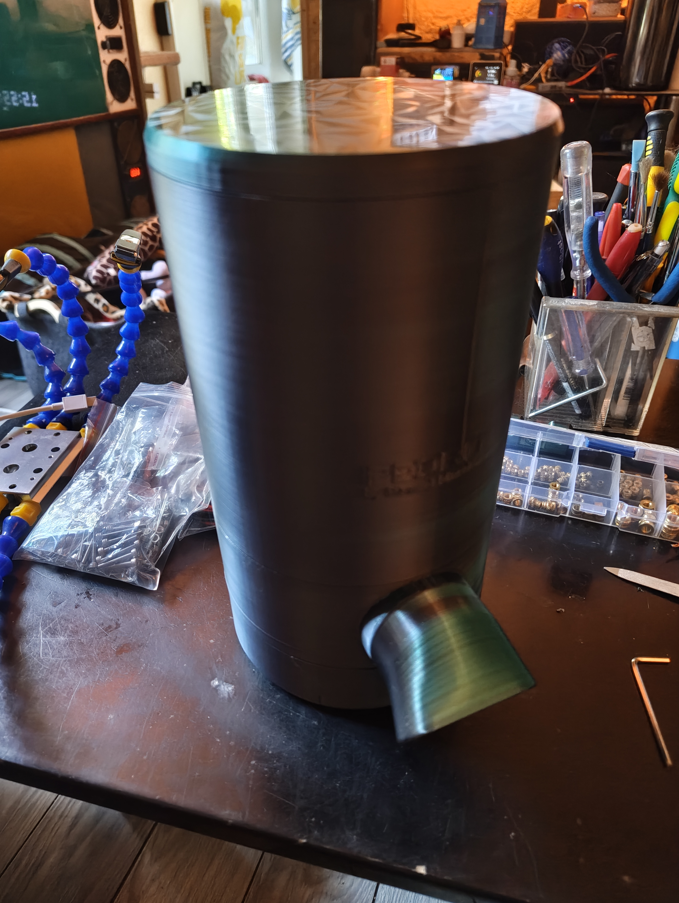
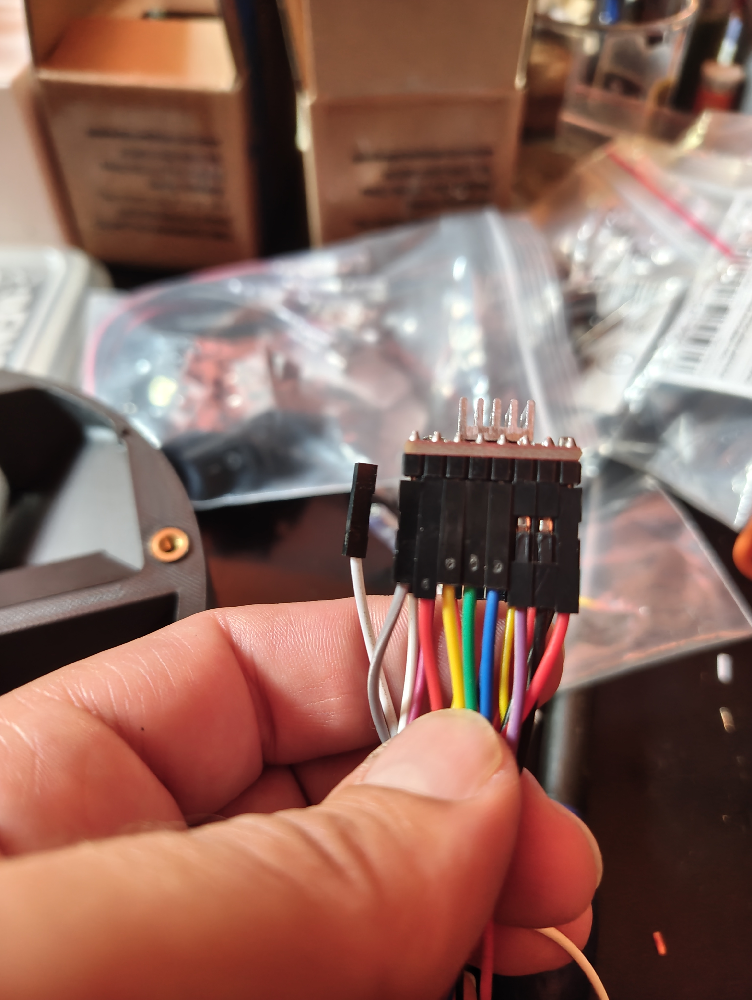
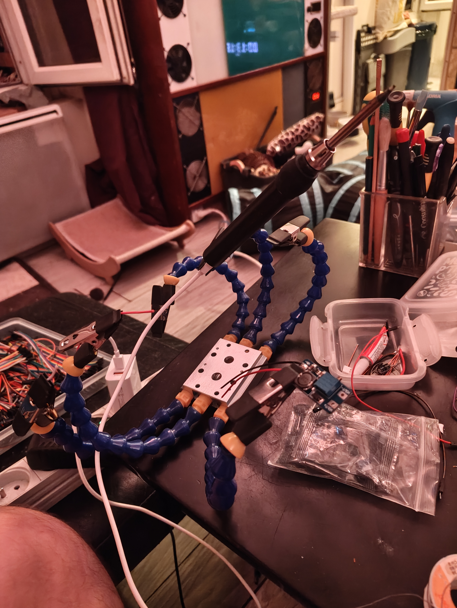
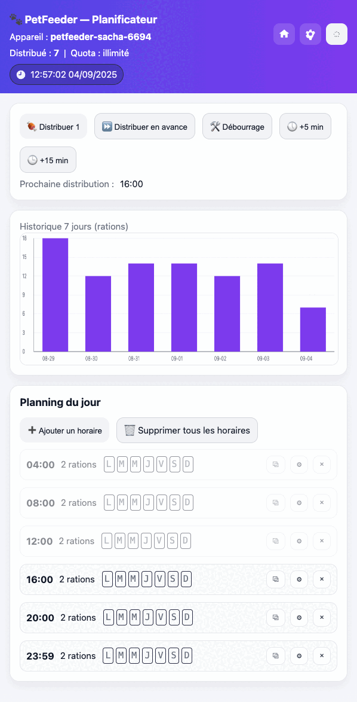
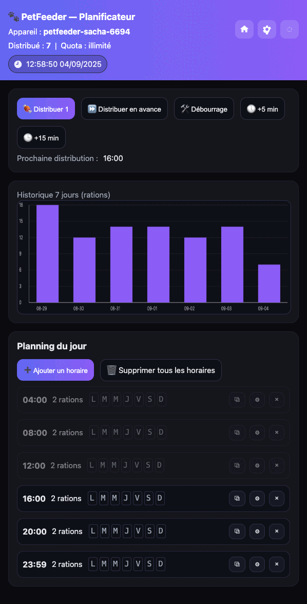

# PetFeeder

<a href="#français" target="_blank">Français</a> | <a href="#english" target="_blank">English</a>

---

## English

### Overview
PetFeeder is an open-source firmware to retrofit stepper-based pet feeders (auger type) with Wi-Fi connectivity for any animal that eats kibble.
It was born from the need to network-enable the paid <a href="https://ko-fi.com/s/698e04b7e3" target="_blank">PEDRO feeder by Manutechlab</a>
(<a href="https://www.youtube.com/watch?v=Uv0lsih8JRA" target="_blank">YouTube video</a>), which adjusts with two potentiometers and lacks connectivity.
While our build uses the PEDRO mechanical kit, the ESP8266 + A4988 setup can drive any dispenser based on a NEMA17 or similar stepper motor.
It offers a modern web interface, daily schedule, OTA updates and optional MQTT/webhook integrations.
See [CHANGELOG](CHANGELOG.md) for release notes.

### Features
- Self‑hosted Wi‑Fi configuration portal (WiFiManager)
- Responsive Web UI with schedule management and manual actions
- Daily quota tracking with 7‑day history chart
- Expert mode toggle to reveal advanced settings
- OTA firmware updates with configurable password
- Local JSON API endpoints
- Physical button for feed/unclog/safe‑mode toggle
- Optional MQTT and webhook notifications

### Hardware
- Wemos D1 mini (ESP8266)
- A4988 stepper driver
- NEMA17 stepper motor
- 12 V power supply + 100–220 µF capacitor
- Push button between D2 and GND
- 3D printed parts from the paid <a href="https://ko-fi.com/s/698e04b7e3" target="_blank">PEDRO project by Manutechlab</a>
  (<a href="https://www.youtube.com/watch?v=Uv0lsih8JRA" target="_blank">YouTube video</a>); any NEMA17‑based feeder can be adapted

### Wiring
| Wemos D1 mini | A4988 | Notes |
|---------------|-------|-------|
| D5 (GPIO14)   | DIR   | direction |
| D6 (GPIO12)   | STEP  | step pulse |
| D7 (GPIO13)   | EN    | LOW = enabled |
| 3V3           | VDD   | logic power |
| 3V3           | SLEEP & RESET | bridge together |
| 12V           | VMOT  | motor power |
| GND           | GND   | common ground |

Motor coils (NEMA17 17HE12‑1204S example):
- Coil A → A4988 1A/1B: black / blue
- Coil B → A4988 2A/2B: green / red

### Software Setup
1. Install <a href="https://www.arduino.cc/en/software" target="_blank">Arduino IDE</a> or `arduino-cli` with ESP8266 board package.
2. Install the libraries: WiFiManager, ArduinoJson and PubSubClient.
3. Open `PetFeeder.ino` and select **ESP8266 › LOLIN(Wemos) D1 R2 & mini**.
4. Flash the board. On first boot the access point `<device_name>-SETUP` will appear.
5. Connect and configure Wi‑Fi credentials, timezone, quotas, etc.

### ESP8266 Wi‑Fi notes

- The setup portal uses an open WiFiManager AP named `<device_name>-SETUP-XXXX`, forced to channel 6, at `http://192.168.4.1`.
- A **Reset Wi‑Fi** button is available from the normal Settings page and from the WiFiManager portal. It clears only the ESP8266 Wi‑Fi credentials, then reboots into setup AP mode.
- If an ESP8266 sees the home SSID but fails to connect, or the setup SSID appears/disappears, check the home access point channel. We reproduced an incompatibility with a new home AP on channel 1; moving the home AP to channel 5 made the ESP8266 connect reliably again. Keeping the home AP on a fixed 2.4 GHz channel such as 5 or 6, with 20 MHz width, is recommended.

Below are screenshots of the web interface:

### Release process
1. Increment `FW_VERSION` in `PetFeeder.ino`.
2. Add a new entry to `CHANGELOG.md` describing the changes.
3. Commit the modifications.
4. Tag the commit (e.g. `git tag vX.Y && git push origin vX.Y`).
5. Publish the GitHub release for the tag to run the release workflow and attach the firmware binary.

### API & MQTT
- `GET /status` – JSON state
- `GET /feed?n=1` – dispense `n` rations
- `GET /unclog` – reverse/forward to clear jams
- `/api/schedule` – GET/POST schedule
- MQTT topic prefix: `<cfg.mqtt_topic>` (e.g. `petfeeder/cmd/feed`)

### Credits
Mechanical design derived from the PEDRO project by Manutechlab. Electronics and firmware rewritten for ESP8266 connectivity.

<a href="https://ko-fi.com/s/698e04b7e3" target="_blank">PEDRO project by Manutechlab</a>

<a href="https://www.youtube.com/watch?v=Uv0lsih8JRA" target="_blank">YouTube video</a>
  
### License
This project is released under the MIT License. See <a href="LICENSE" target="_blank">LICENSE</a>.

---

## Français

### Aperçu
PetFeeder est un firmware open-source pour connecter des distributeurs de croquettes pour animaux à moteur pas-à-pas (type vis sans fin) via le Wi-Fi.
Il est né du besoin de rendre connecté le projet payant <a href="https://ko-fi.com/s/698e04b7e3" target="_blank">PEDRO de Manutechlab</a>
(<a href="https://www.youtube.com/watch?v=Uv0lsih8JRA" target="_blank">vidéo YouTube</a>) qui se règle avec deux potentiomètres et n'est pas connecté.
Même si les exemples utilisent le kit mécanique PEDRO, ce firmware peut rendre connecté n'importe quel distributeur basé sur un moteur NEMA17 ou équivalent.
Il propose une interface web moderne, un planning journalier, des mises à jour OTA et des intégrations MQTT/webhook facultatives.
Voir le [CHANGELOG](CHANGELOG.md) pour les notes de version.

### Fonctionnalités
- Portail de configuration Wi‑Fi autonome (WiFiManager)
- Interface Web responsive pour gérer le planning et les actions manuelles
- Suivi du quota journalier avec graphique sur 7 jours
- Mode Expert pour afficher les paramètres avancés
- Mises à jour OTA avec mot de passe configurable
- API JSON locale
- Bouton physique pour nourrir/débourrer/activer le mode sécurisé
- Notifications MQTT et webhook en option

### Matériel
- Wemos D1 mini (ESP8266)
- Driver A4988
- Moteur pas‑à‑pas NEMA17
- Alimentation 12 V + condensateur 100–220 µF
- Bouton poussoir entre D2 et GND
- Pièces imprimées en 3D : projet payant <a href="https://ko-fi.com/s/698e04b7e3" target="_blank">PEDRO de Manutechlab</a>
  (<a href="https://www.youtube.com/watch?v=Uv0lsih8JRA" target="_blank">vidéo YouTube</a>) ; tout distributeur à moteur NEMA17 peut être adapté

### Câblage
| Wemos D1 mini | A4988 | Notes |
|---------------|-------|-------|
| D5 (GPIO14)   | DIR   | sens de rotation |
| D6 (GPIO12)   | STEP  | impulsion de pas |
| D7 (GPIO13)   | EN    | LOW = activé |
| 3V3           | VDD   | alimentation logique |
| 3V3           | SLEEP & RESET | ponter ensemble |
| 12V           | VMOT  | puissance moteur |
| GND           | GND   | masse commune |

Bobines moteur (ex. NEMA17 17HE12‑1204S) :
- Bobine A → A4988 1A/1B : noir / bleu
- Bobine B → A4988 2A/2B : vert / rouge

### Mise en route
1. Installer l'<a href="https://www.arduino.cc/en/software" target="_blank">IDE Arduino</a> ou `arduino-cli` avec la carte ESP8266.
2. Installer les bibliothèques : WiFiManager, ArduinoJson et PubSubClient.
3. Ouvrir `PetFeeder.ino` et choisir **ESP8266 › LOLIN(Wemos) D1 R2 & mini**.
4. Téléverser le firmware. Au premier démarrage, le point d'accès `<device_name>-SETUP` apparaît.
5. S'y connecter pour configurer le Wi‑Fi, le fuseau horaire, les quotas, etc.

### Notes Wi‑Fi ESP8266

- Le portail de configuration utilise un AP WiFiManager ouvert nommé `<device_name>-SETUP-XXXX`, forcé sur le canal 6, disponible sur `http://192.168.4.1`.
- Un bouton **Effacer WiFi** est disponible dans la page Paramètres normale et dans le portail WiFiManager. Il efface uniquement les identifiants Wi‑Fi stockés par l’ESP8266, puis redémarre en mode AP setup.
- Si l’ESP8266 voit le SSID domestique mais ne s’y connecte pas, ou si le SSID setup apparaît/disparaît, vérifier le canal du point d’accès domestique. Un problème a été reproduit avec un nouvel AP domestique en canal 1 ; le passage de cet AP en canal 5 a rendu la connexion ESP8266 fiable. Il est recommandé de garder le Wi‑Fi domestique 2,4 GHz sur un canal fixe comme 5 ou 6, en largeur 20 MHz.

Voici quelques captures d’écran de l’interface :

### Processus de release
1. Incrémenter `FW_VERSION` dans `PetFeeder.ino`.
2. Mettre à jour `CHANGELOG.md` avec les nouveautés.
3. Commiter les modifications.
4. Créer puis pousser le tag Git correspondant : `git tag vX.Y && git push origin vX.Y`.
5. Publier la release GitHub associée pour déclencher le workflow et joindre le binaire du firmware.

### API & MQTT
- `GET /status` – état en JSON
- `GET /feed?n=1` – distribue `n` rations
- `GET /unclog` – débloque la vis sans fin
- `/api/schedule` – GET/POST du planning
- Préfixe de topic MQTT : `<cfg.mqtt_topic>` (ex. `petfeeder/cmd/feed`)

### Remerciements
Design mécanique dérivé du projet PEDRO de Manutechlab. Électronique et firmware réécrits pour l’ESP8266.

<a href="https://ko-fi.com/s/698e04b7e3" target="_blank">PEDRO project by Manutechlab</a>

<a href="https://www.youtube.com/watch?v=Uv0lsih8JRA" target="_blank">YouTube video</a>
  
### Licence
Ce projet est publié sous licence MIT. Voir <a href="LICENSE" target="_blank">LICENSE</a>.
